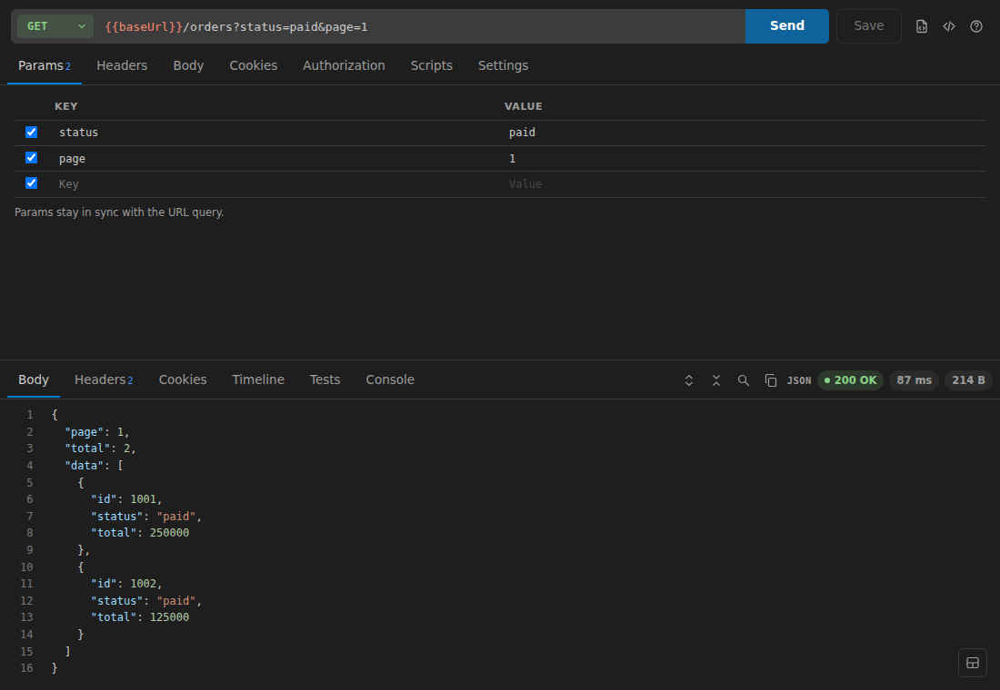
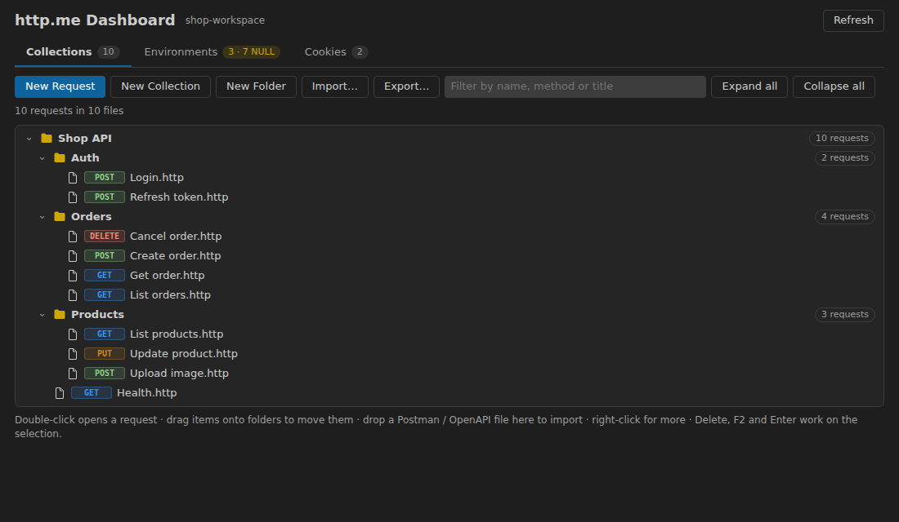
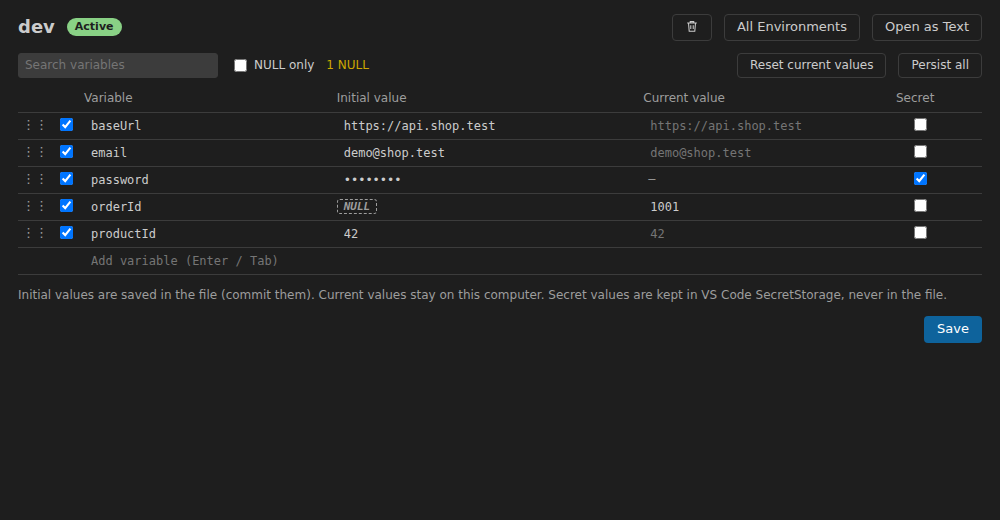
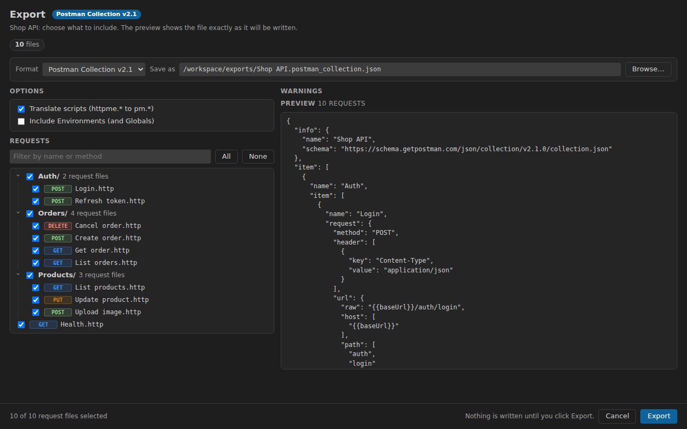
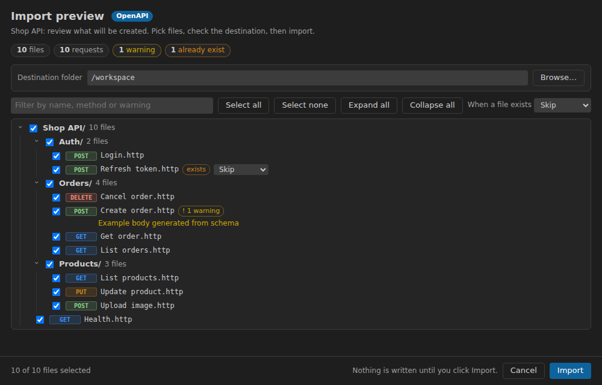

# http.me

[English](README.md) | Bahasa Indonesia

HTTP client ringan untuk VS Code, ala Postman, dengan fokus **hemat RAM**: request disimpan sebagai file `.http` biasa di repository, lengkap dengan request editor, response viewer, collection, Environment, cookie, history, serta import / export Postman dan OpenAPI.



## Fitur

- **Request editor** – method, URL dengan `{{variable}}`, query param, header, body (JSON, teks, XML, form, multipart dengan file, binary), 12 jenis authorization (Basic, Bearer, API key, OAuth 2.0, Digest, AWS Signature, …). Kirim dengan `Ctrl+Enter`, bisa di-cancel kapan saja, sampai 6 request berjalan paralel.
- **Response viewer** – JSON / XML / HTML / CSV, pencarian, header, cookie, timeline redirect, hasil test, dan console. Response besar (> 1 MB) tidak ditahan di memory: dibuka di editor. Request lambat yang selesai setelah Anda pindah ke request lain memindahkan panel Response ke hasilnya; response tidak hilang saat pindah tab.
- **Collection = file `.http`** – satu request per file (kompatibel REST Client / JetBrains), folder = folder biasa, jadi semuanya bisa di-review di Git. Sidebar dengan drag & drop, rename, duplicate, Copy as cURL / PowerShell, dan **Dashboard** yang menggabungkan Collections, Environments, Cookies, History, dan Backups dalam satu halaman. Close All / Close All Unpinned / tombol close di Open menanyakan simpan bila ada request yang belum disimpan.
- **Environment** – dev / uat / prod dengan key yang sama (tombol Set Active selalu terlihat di Dashboard › Environments), `NULL` untuk nilai yang belum diisi, Globals, variable collection, nilai rahasia disimpan di SecretStorage VS Code (tidak pernah di file), serta import / export `http-client.env.json`.
- **History** – di Dashboard, filter berdasarkan teks dan tanggal (From / To, Today, All dates). Klik entri untuk membuka request beserta response tersimpan (status, header, body sampai 64 KB), ditandai "From History: executed <tanggal jam> (n min ago)". Semua entri dibuka di satu tab untitled `history.http` yang ditimpa entri berikutnya. Aksi: Send again, Copy cURL, Remove, Clear All.
- **Backups** – History dan request sementara (tab New Request yang belum disimpan) dibackup otomatis ke `<workspace>/exports/history-backup/` dan `exports/temp-backup/` (sekali sehari bila ada perubahan, atau saat isi bertambah >= 2 MB; 30 file terbaru per jenis disimpan). Pakai **Back Up Now** / **Import** di tab Backups. File backup berisi request dan response, jadi tambahkan `exports/` ke `.gitignore`.
- **Cookie dan sesi login** – cookie jar per Environment, login ulang otomatis saat sesi habis.
- **Request timeout** – default 10 menit; ubah lewat setting `httpme.request.timeout` (detik) atau `http.me: Set Request Timeout…`, atau timpa per request dengan `# @timeout <detik>`. Berlaku untuk request, request login, dan request token OAuth 2.0.
- **Script** – `pre-request.js` dan `post-request.js` per folder atau request dengan helper `httpme.*` dan test.
- **Import** – cURL, Postman Collection v2.0 / v2.1 (script ikut diterjemahkan), Postman Environment, OpenAPI 3.x / Swagger 2.0 (JSON atau YAML, dari file atau URL), dengan preview dan re-import dari sumbernya.
- **Export** – ke Postman Collection v2.1 atau OpenAPI 3.0.3 / 3.1.0 dengan pratinjau langsung, pilihan request, dan Environment sebagai file Postman atau JetBrains. Nilai rahasia tidak pernah ditulis kecuali Anda konfirmasi.
- **Hemat RAM** – tanpa dependency runtime selain `yaml` (dimuat hanya saat perlu), aktivasi malas, dan webview hanya untuk tab yang terlihat.

## Tangkapan layar

| Dashboard | Environments |
|---|---|
|  |  |

| Export | Preview import |
|---|---|
|  |  |

## Mulai cepat

1. Buka sebuah folder lalu jalankan **http.me: New Request** (atau buat file `.http`).
2. Ketik URL, tekan **Send**, lalu **Save**: request tersimpan sebagai file `.http`.
3. Buat **Environment** (`http.me: New Environment`) dan pakai `{{baseUrl}}` di URL.
4. Punya collection Postman atau spec OpenAPI? Pakai **http.me: Import…**.
5. Buka **Dashboard** dengan `Ctrl+Alt+D` (`Cmd+Alt+D` di macOS).

### File `.http`

```http
### Create order
POST {{baseUrl}}/orders
Content-Type: application/json

{"items":[{"sku":"TSH-001","qty":2}]}
```

## Command dan shortcut

| Command | Shortcut |
|---|---|
| http.me: Send Request | `Ctrl+Enter` |
| http.me: Open Dashboard | `Ctrl+Alt+D` |
| http.me: Select Environment | `Ctrl+Alt+E` |
| http.me: Next / Previous Environment | `Ctrl+Alt+]` / `Ctrl+Alt+[` |
| http.me: Set Request Timeout… | Command Palette |
| http.me: Import… / Export… | Command Palette |
| http.me: Back Up History and Temp Now | Command Palette |
| http.me: Import History or Temp Backup… | Command Palette |

Semua command ada di kategori **http.me** pada Command Palette.

## Privasi

http.me tidak memakai telemetri dan hanya mengirim request ke tujuan yang Anda tentukan. Nilai rahasia tetap di SecretStorage VS Code; History menyimpan header response, tetapi header `Set-Cookie`, `Authorization`, dan `Cookie` tidak disimpan.

## Masukan

Issue dan ide: <https://github.com/exeldtarkus/http.me/issues>
