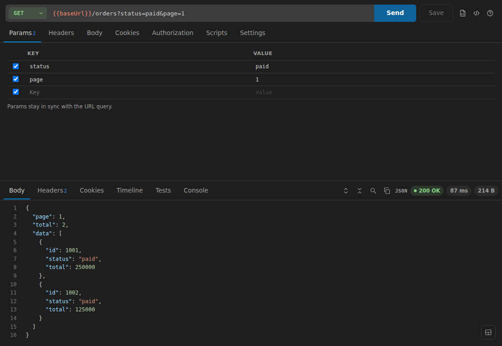
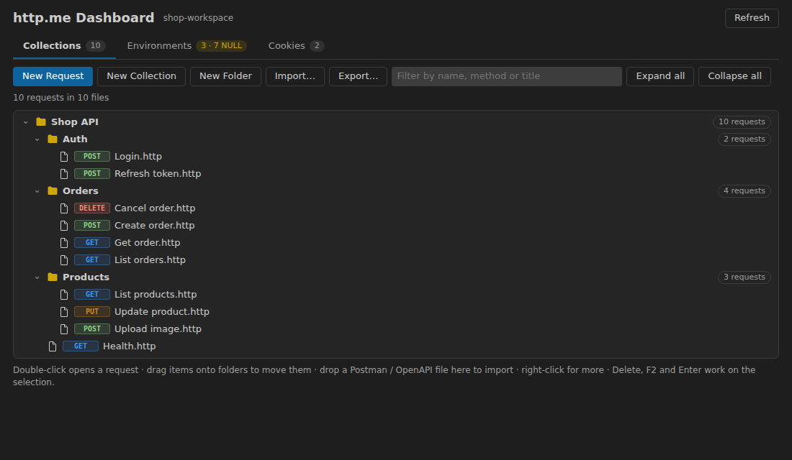
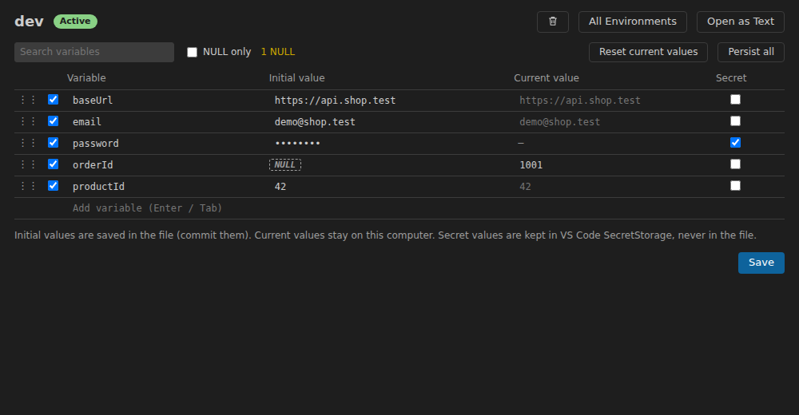
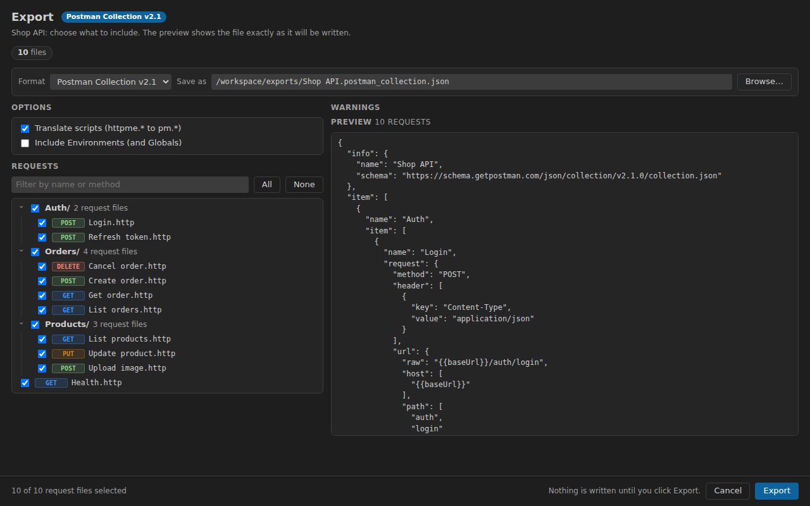
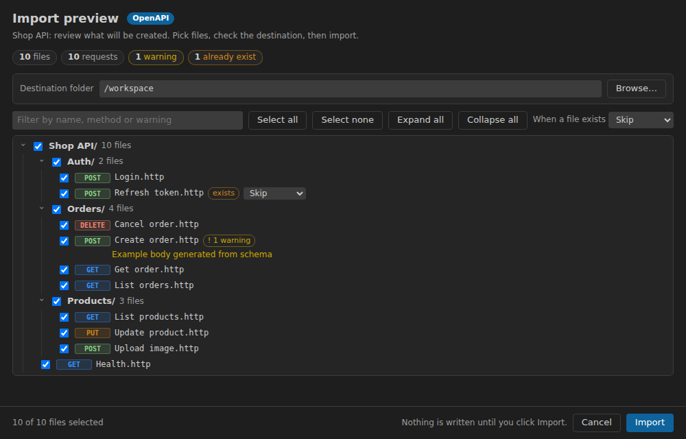

# http.me

English | [Bahasa Indonesia](README.id.md)

A lightweight HTTP client for VS Code, in the spirit of Postman, built to stay **small in memory**: requests are plain `.http` files in your repository, with a request editor, response viewer, collections, Environments, cookies, history and import / export for Postman and OpenAPI.



## Features

- **Request editor** – method, URL with `{{variables}}`, query params, headers, body (JSON, text, XML, form, multipart with files, binary), 12 authorization types (Basic, Bearer, API key, OAuth 2.0, Digest, AWS Signature, …). Send with `Ctrl+Enter`, cancel any time, up to 6 requests in parallel.
- **Response viewer** – JSON / XML / HTML / CSV, search, headers, cookies, redirect timeline, test results and console output. Large responses (> 1 MB) are not kept in memory: open them in an editor instead.
- **Collections are `.http` files** – one request per file (REST Client / JetBrains compatible), folders are normal folders, so everything is reviewable in Git. Sidebar with drag & drop, rename, duplicate, Copy as cURL / PowerShell, and a **Dashboard** with Collections, Environments and Cookies in one page.
- **Environments** – dev / uat / prod with the same keys, `NULL` for values that are not filled yet, Globals, collection variables, secret values kept in VS Code SecretStorage (never in the file), and import / export of `http-client.env.json`.
- **Cookies and login sessions** – a cookie jar per Environment, automatic re-login when a session expires.
- **Scripts** – `pre-request.js` and `post-request.js` per folder or request with `httpme.*` helpers and tests.
- **Import** – cURL, Postman Collection v2.0 / v2.1 (with scripts translated), Postman Environments, OpenAPI 3.x / Swagger 2.0 (JSON or YAML, from a file or a URL), with a preview and re-import from the source.
- **Export** – to Postman Collection v2.1 or OpenAPI 3.0.3 / 3.1.0 with a live preview, request selection, and Environments as Postman or JetBrains files. Secrets are never written unless you confirm.
- **Low memory by design** – no runtime dependencies except `yaml` (loaded only when needed), lazy activation, and webviews only for visible tabs.

## Screenshots

| Dashboard | Environments |
|---|---|
|  |  |

| Export | Import preview |
|---|---|
|  |  |

## Getting started

1. Open a folder and run **http.me: New Request** (or create a `.http` file).
2. Type a URL, press **Send**, and **Save**: the request is stored as a `.http` file.
3. Create an **Environment** (`http.me: New Environment`) and use `{{baseUrl}}` in your URLs.
4. Have a Postman collection or an OpenAPI spec? Use **http.me: Import…**.
5. Open the **Dashboard** with `Ctrl+Alt+D` (`Cmd+Alt+D` on macOS).

### A `.http` file

```http
### Create order
POST {{baseUrl}}/orders
Content-Type: application/json

{"items":[{"sku":"TSH-001","qty":2}]}
```

## Commands and shortcuts

| Command | Shortcut |
|---|---|
| http.me: Send Request | `Ctrl+Enter` |
| http.me: Open Dashboard | `Ctrl+Alt+D` |
| http.me: Select Environment | `Ctrl+Alt+E` |
| http.me: Next / Previous Environment | `Ctrl+Alt+]` / `Ctrl+Alt+[` |
| http.me: Import… / Export… | Command Palette |

All commands are under the **http.me** category in the Command Palette.

## Privacy

http.me has no telemetry and sends requests only where you tell it to. Secret values stay in VS Code SecretStorage; the `Authorization` header and cookies are not saved in History.

## Feedback

Issues and ideas: <https://github.com/exeldtarkus/http.me/issues>
